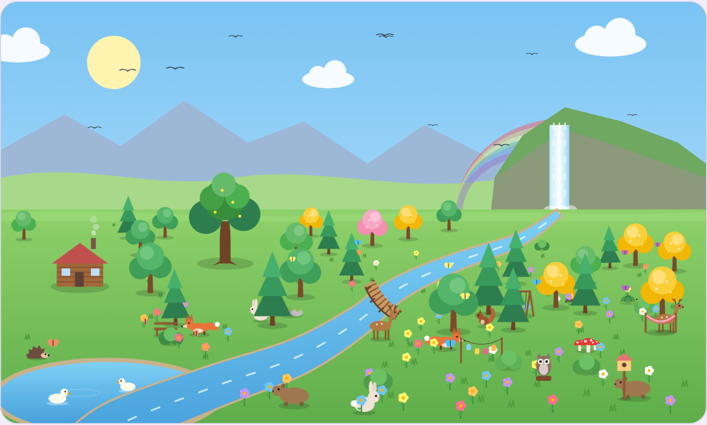
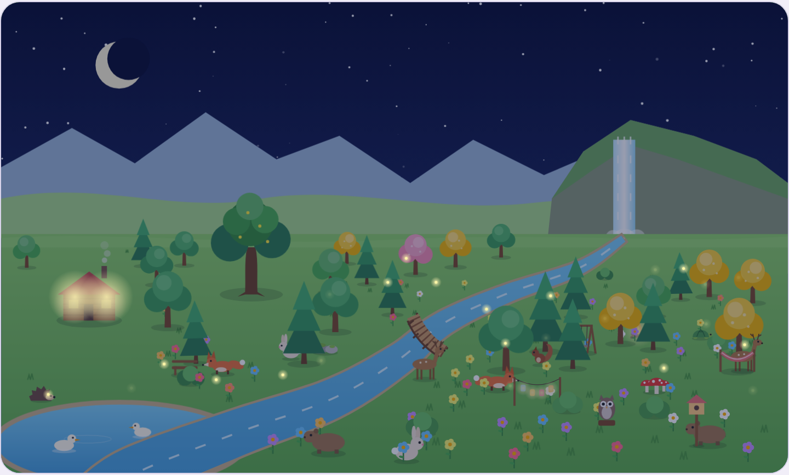
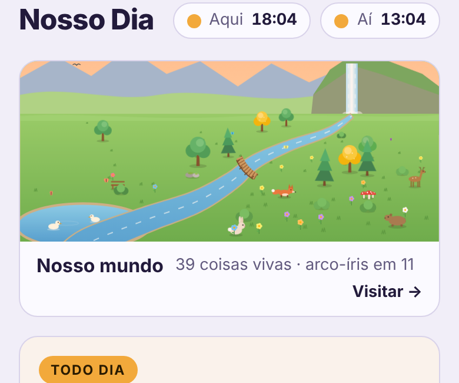
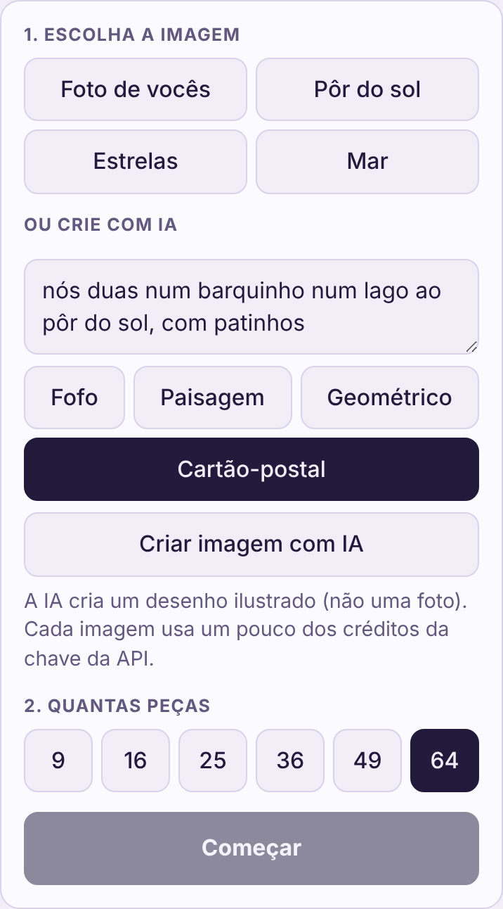
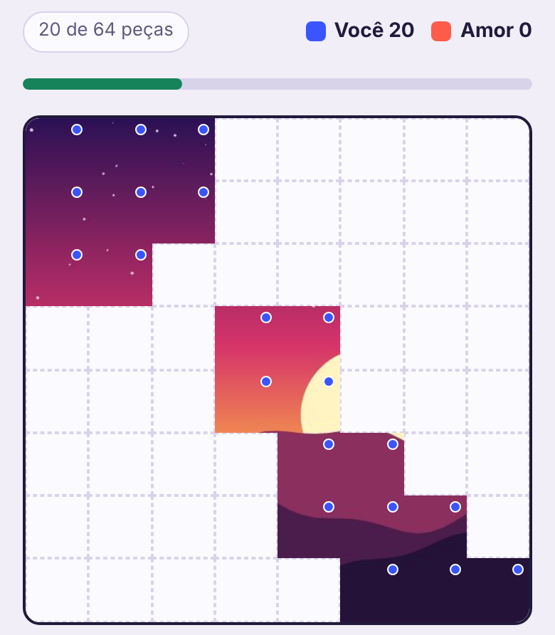
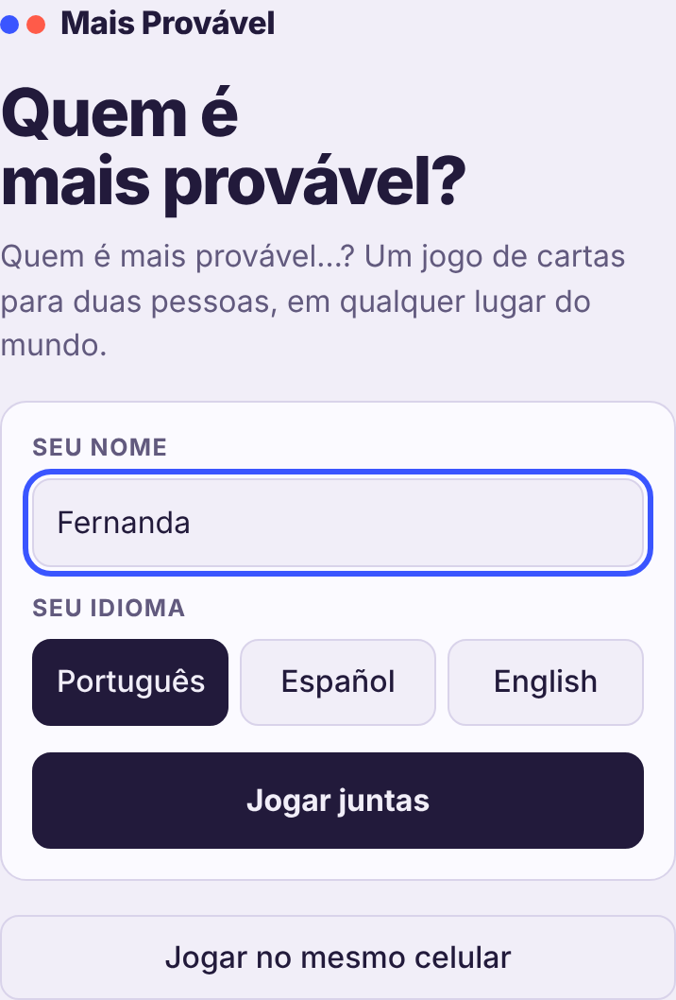

# Novidades do Nosso Dia

## 22 de outubro de 2026

### 🌳 Nosso mundo

Uma florestinha que cresce com tudo o que vocês fazem juntas no app, igual nos dois celulares.

- 🌸 gratidão vira flor · 🌳 escuta vira árvore · 🦊 "Fizemos!" traz um animal
- 🍄 quebra-cabeça completo cria um cantinho · 🦋 verdade ou desafio solta borboletas · 🐦 sintonia chama passarinhos
- Surpresas pelo caminho: riacho, ponte, cachoeira, lago, arco-íris, cabana e a árvore da vida
- O céu segue a hora de quem olha; à noite tem lua, estrelas e vaga-lumes
- O que vocês já fizeram antes também conta: o mundo nasce crescido

 

Uma miniatura fica no topo da aba **Hoje**; é só tocar para visitar.

### 🧩 Quebra-cabeça: imagens com IA e até 64 peças

 

- Descrevam a cena e escolham um estilo (fofo, paisagem, geométrico ou cartão-postal): a IA desenha uma ilustração para montar
- Novos tamanhos: 36, 49 e 64 peças
- A IA precisa da chave da API em **Ajustes** e cria desenhos, não fotos

### 🎴 Mais Provável sem código de sala

O app é só de vocês duas, então acabou o código: **Jogar juntas** entra direto na sala do casal. Jogar no mesmo celular continua igual.
